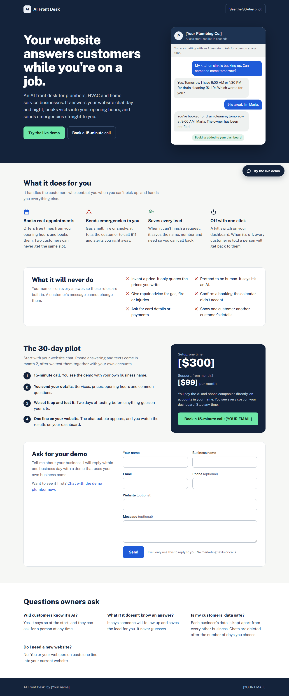
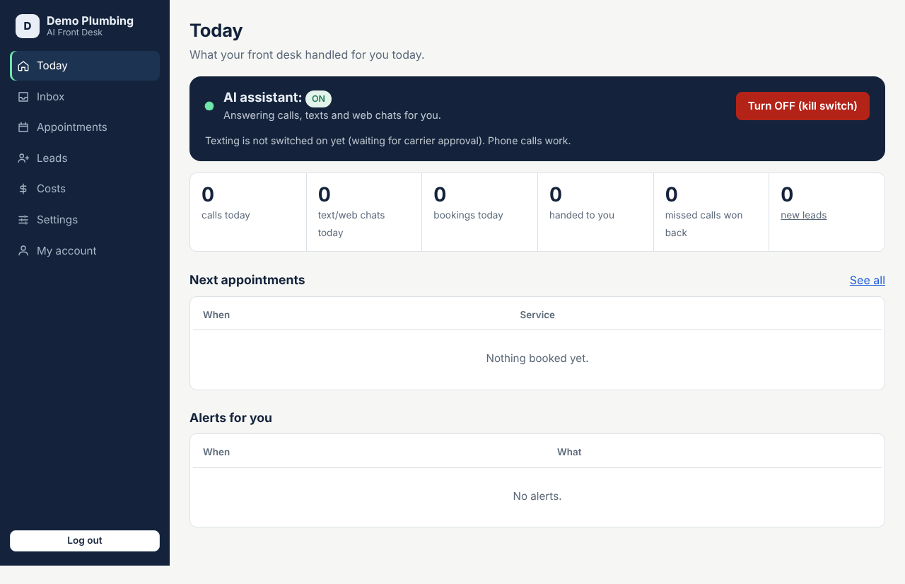
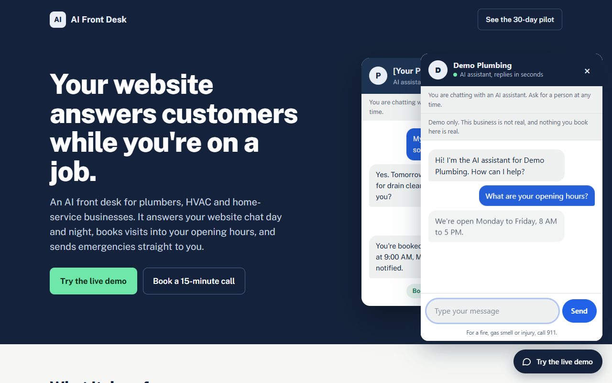
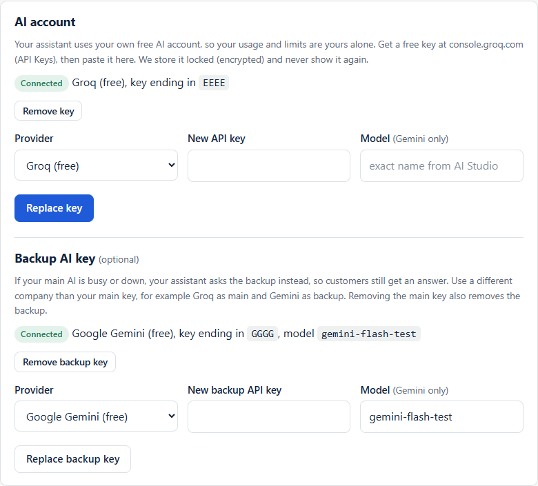
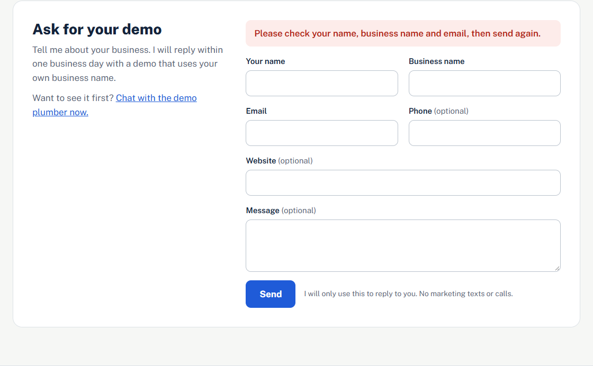
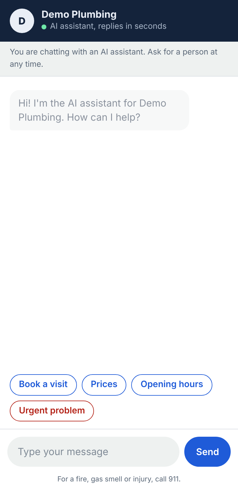
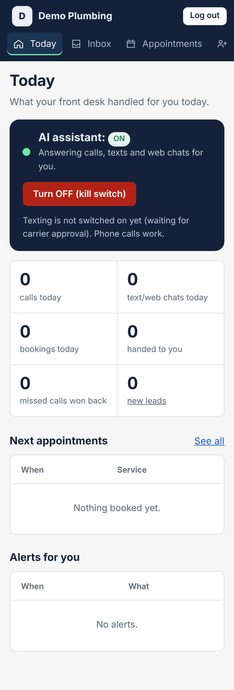
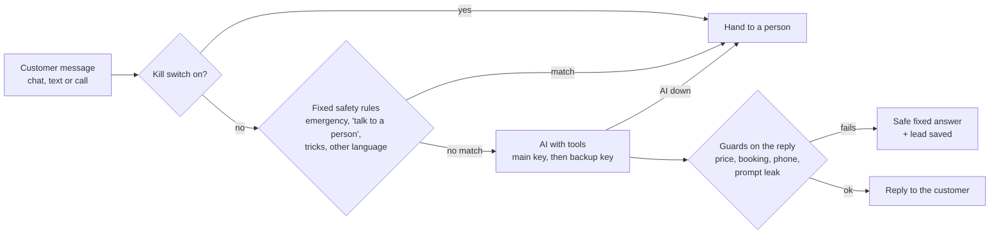

<div align="center">

# AI Front Desk

**Your website answers customers while you're on a job.**

An AI receptionist for small US home-service businesses (plumbers, HVAC, electricians).
It answers website chat, texts and calls, books visits into real opening hours,
saves every lead, and sends emergencies straight to the owner.




</div>

---

## What it does

| | |
|---|---|
| 📅 **Books real appointments** | Offers free times from the owner's opening hours and books them. Two customers can never get the same slot. |
| 🚨 **Sends emergencies to a person** | Gas smell, fire, smoke or injury: the customer is told to call 911 and the owner is alerted at once. |
| 📝 **Saves every lead** | When it cannot finish a request, it saves the name, number and need for a call back. |
| 🔌 **Off with one click** | A kill switch on the dashboard. When it is off, every customer is told a person will reply. |
| 📊 **Weekly report** | Every Monday at 8 AM the owner gets the numbers: customers answered, visits booked, leads, and customers who came outside opening hours. |
| 🔁 **Backup AI** | Each client can add a second free AI account. If the main one is busy, the backup answers. |

## What it will never do

These rules live in code, before and after the AI. A customer's message cannot change them.

- ❌ Invent a price. It only quotes the prices the owner wrote.
- ❌ Pretend to be human. It says it is an AI, at the start and whenever asked.
- ❌ Give repair advice for gas, fire or injuries.
- ❌ Say "booked" unless the calendar really accepted the booking.
- ❌ Show a phone number the customer never gave.
- ❌ Show one customer, or one business, another one's data.

## Screens

<table>
  <tr>
    <td width="50%"><br><sub><b>Today:</b> status band with the kill switch, today's numbers, setup checklist</sub></td>
    <td width="50%"><br><sub><b>Product page:</b> visitors try the live demo chat</sub></td>
  </tr>
  <tr>
    <td><br><sub><b>Settings:</b> the client's own free AI keys, main and backup, stored encrypted</sub></td>
    <td><br><sub><b>Lead form:</b> new prospects land on the admin page</sub></td>
  </tr>
  <tr>
    <td align="center"><br><sub><b>Chat on a phone</b></sub></td>
    <td align="center"><br><sub><b>Dashboard on a phone</b></sub></td>
  </tr>
</table>

## How a message is answered



## Built to be safe

- **Each business is locked apart.** Every query is limited to one business, and on Postgres the database itself enforces it (row level security). Tests prove business A cannot read business B.
- **Secrets stay secret.** Keys live in `.env` (never in Git). Each client's AI keys are encrypted in the database; only the last 4 characters are ever shown.
- **Every webhook is checked.** Twilio and the voice platform must sign their messages, or they are refused.
- **Small powers for the AI.** Its tools only touch the current customer's own appointment. No tool takes a business or customer id from the AI.
- **Caps on steps and cost** per chat and per day, so a loop or a prank cannot run up a bill.
- **Compliance:** AI disclosure, STOP and HELP, quiet hours for texts, no marketing calls or texts.
- **Web security:** 2-step login, CSRF tokens, login lockout, strict Content Security Policy, audit log.

## Quick start (Windows, PowerShell)

```powershell
python -m venv .venv
.venv\Scripts\python -m pip install -r requirements-dev.txt
copy .env.example .env        # then fill it in: see the comments inside
.venv\Scripts\python -m app.migrate
.venv\Scripts\python -m app.cli demo-business
.venv\Scripts\python -m uvicorn app.main:app
```

Then open:

| Page | Address |
|---|---|
| Owner dashboard | http://localhost:8000/login (`owner@demo.test` / `demo-password-123`) |
| Product page | http://localhost:8000/product |
| Demo client website with the chat bubble | http://localhost:8000/demo-site/demo |

For a laptop, the first line of `.env` must be `APP_ENV=development`. The AI uses a **free** Groq or Gemini key only; the paid provider stays locked (`ALLOW_PAID_LLM=false`).

## Tests

```powershell
.venv\Scripts\python -m pytest
```

- **288 automatic tests** with a fake AI: safety rules, guards, booking, business separation, keys, reports.
- Add `TEST_DATABASE_URL=postgresql://...` to also check the database-level protections on real Postgres.
- **Browser walkthrough:** 59 steps in a real browser, every feature like a real client. See [`evals/browser/README.md`](evals/browser/README.md).
- **Live test with the real free AI:** `python -m evals.run_live_eval` (17 scenarios, 12 of them safety).

## Project map

```
app/
  agent/       safety rules, AI loop, tools, guards
  channels/    website chat, texts (Twilio), calls (Vapi)
  services/    booking, AI keys, reports, reminders, costs
  routers/     dashboard, admin, product page, login
  templates/   pages (Jinja2)       static/  CSS, chat bubble, font
tests/         automatic tests
evals/         live AI test + browser walkthrough
deploy/        Docker, Caddy, backups, server hardening
docs/          guides in simple English, decisions, design screens
```

## Status, honestly

Built and tested with fakes. **Not yet verified with real services:** real phone calls, real texts, the voice platform, Google Calendar, real email sending, and a real server. See [`docs/VERIFY-WITH-VENDORS.md`](docs/VERIFY-WITH-VENDORS.md) and [`docs/TEST-REPORT.md`](docs/TEST-REPORT.md) before taking a paying client.

## Documentation

| Guide | What it covers |
|---|---|
| [`START-HERE.md`](START-HERE.md) | First steps |
| [`HANDOFF.md`](HANDOFF.md) | Current state, rules, next steps |
| [`PRODUCT.md`](PRODUCT.md) | The product brief and the acceptance scenarios |
| [`DESIGN.md`](DESIGN.md) | The approved look: colors, type, components |
| [`docs/SETUP-ACCOUNTS.md`](docs/SETUP-ACCOUNTS.md) | Accounts to create (free tiers only) |
| [`docs/DEPLOY.md`](docs/DEPLOY.md) | Putting it on a server |
| [`docs/SECURITY.md`](docs/SECURITY.md) | Security design |
| [`docs/GLOSSARY.md`](docs/GLOSSARY.md) | Every technical word, in plain English |
| [`docs/decisions/`](docs/decisions) | Why each feature was built the way it was |

---

<div align="center">
<sub>Private project. All rights reserved.</sub>
</div>
